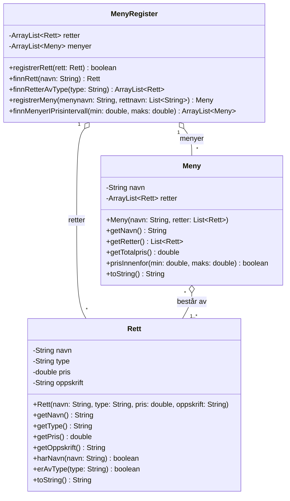

# UML-diagram – Menyregister



## Samme diagram som tekst

```
+------------------------------------------------------------+
|                       MenyRegister                         |
+------------------------------------------------------------+
| - retter : ArrayList<Rett>                                 |
| - menyer : ArrayList<Meny>                                 |
+------------------------------------------------------------+
| + registrerRett(rett : Rett) : boolean                     |
| + finnRett(navn : String) : Rett                           |
| + finnRetterAvType(type : String) : ArrayList<Rett>        |
| + registrerMeny(menynavn : String,                         |
|                 rettnavn : List<String>) : Meny            |
| + finnMenyerIPrisintervall(min : double,                   |
|                 maks : double) : ArrayList<Meny>           |
+------------------------------------------------------------+
        | 1                                  | 1
        |                                    |
        | *                                  | *
+---------------------------------+   +--------------------------------------+
|              Meny               |   |                Rett                  |
+---------------------------------+   +--------------------------------------+
| - navn : String                 |   | - navn : String                      |
| - retter : ArrayList<Rett>      |   | - type : String                      |
+---------------------------------+   | - pris : double                      |
| + getNavn() : String            |   | - oppskrift : String                 |
| + getRetter() : List<Rett>      | * |                                      |
| + getTotalpris() : double       |---| + getNavn() : String                 |
| + prisInnenfor(min : double,    |1..*| + getType() : String                |
|        maks : double) : boolean |   | + getPris() : double                 |
| + toString() : String           |   | + getOppskrift() : String            |
+---------------------------------+   | + harNavn(navn : String) : boolean   |
                                      | + erAvType(type : String) : boolean  |
                                      | + toString() : String                |
                                      +--------------------------------------+
```

**Forklaring av relasjonene**

- `MenyRegister` har mange `Rett`-er og mange `Meny`-er.
- En `Meny` består av én eller flere `Rett`-er, og en `Rett` kan inngå i mange `Meny`-er (mange-til-mange).
  Dette er *aggregering* (tom rombe): rettene finnes uavhengig av menyene, og flere menyer
  peker på de samme `Rett`-objektene.
- `Meny` regner selv ut totalprisen (`getTotalpris`, `prisInnenfor`), og `Rett` sjekker selv navn og type
  (`harNavn`, `erAvType`). Da blir metodene i `MenyRegister` enkle løkker som bare spør objektene.
